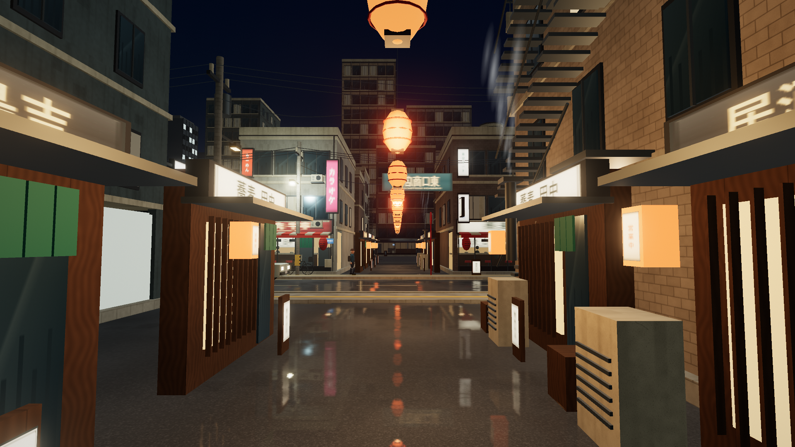
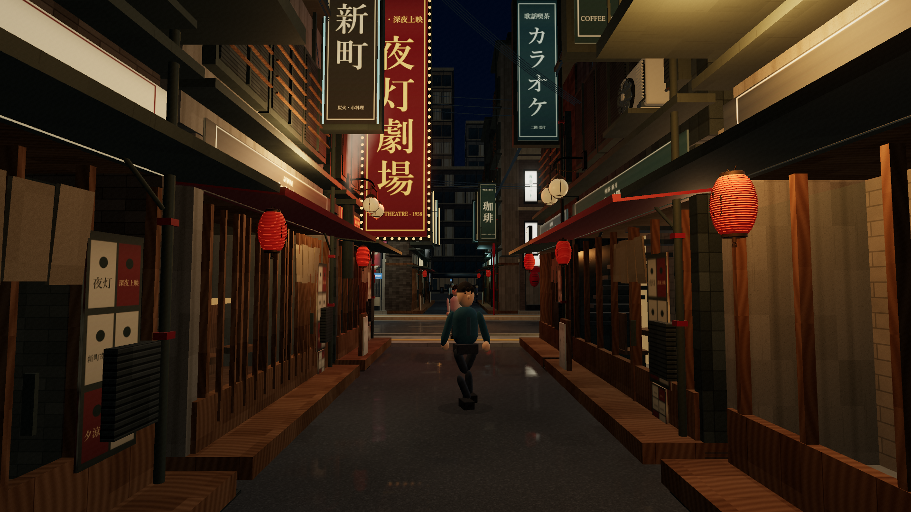

# Quality report — production Pass 1

## Delivery

Pass 1 materially changes the rendered nightlife street. It is a completed first environment pass, not a claim that all twenty sections of the production brief or all later passes are finished.

Start the local development task and use **8 / Yoto nightlife street**, now the default view. The seven earlier viewpoints and controls remain available. The existing HUD was retained; its location option is the only presentation change required to expose the new viewpoint.

Compare the actual 1920 × 1080 scene captures:

| Before | Delivered street |
| --- | --- |
|  |  |

Both use seed 8412, 21:00, the same eye/target and FOV 58°. Agent positions differ because the live simulation continues. Captures contain actual rendered geometry and materials, with no HUD or painted-over results.

## What changed in the world

- Replaced the repeated low alley bars and central lantern row with twelve authored frontages, varied heights, upper-floor treatments, balconies, rain hoods and exposed service equipment.
- Added a large red/amber theatre marquee with real bulb-border geometry, readable vertical business blades, notices, menus and weathered posters. The street now has a clear warm focal point and signs at different depths.
- Added three actual imported GLB families: ribbed paper lanterns, fan/grille condensers and curved twin wall lamps. Their parts are merged by material and instanced at explicit mounting positions.
- Added distinct furniture plans: ramen counter/kitchen, izakaya/bar shelves and stools, cafe tables/cups/espresso equipment, theatre ticket foyer/posters and karaoke entrance stairs/directory.
- Added brick, aged plaster, dark tile, wood, metal and cloth surface treatments. Reduced night ambience, environment wash and pale trim. Reflection patches now contain larger gaps rather than a uniform mirror response.
- Routed bundled services through brackets at pedestrian-safe heights. Steam now comes from the authored exhausts, expands/drifts, fades by age and uses restrained warm/cool tints.
- Fixed a first-teleport Euler-order error exposed by the new east-facing starting view. Review also exposed disconnected capsule leg placement; leg and arm presentation now derives connected joint positions, with a regression test. Characters remain stylized.

## Functional logic retained or added

- Added twelve tagged alley shop thresholds and same-side approach links to the existing navigation graph. These are actual destinations with opening-hour eligibility and visits, rather than decorative crowds.
- Shop staff presentation, collision envelopes and exhausts consume the same authored frontage transforms.
- Existing left-hand traffic, road-crossing interlocks, business/service schedules, population changes and positional audio remain in operation.
- No functional at-grade railway crossing, train stop/boarding, player-enterable interior, rainfall or drying system is claimed in this pass.

## Visual review and refinements

The baseline's most visible discrepancies were repeated overhead glowing lanterns, clipped/blurred sign typography, shallow repeated storefronts, weak business identity and a highly uniform ground sheen.

The first rebuilt capture is retained as [the first review](./quality/captures/nightlife-pass1-first.png). Its most visible problems were pale architectural trim, furniture repeated across businesses, a partly obscured focal marquee, poorly placed/faint exhaust steam and foreground character defects. Refinements darkened trim/ambience, separated the business layouts, moved the marquee forward/down, lowered/tinted the exhaust source, broke up reflection opacity and corrected connected limb placement.

The resulting scene more clearly matches Reference A's red/amber vertical hierarchy, narrow perspective and mounted service detail. It still has cleaner construction, less accumulated clutter and simpler people than the photograph. The remaining gap is visible and has not been hidden behind excessive bloom or a photographic backdrop.

## Validation results

| Check | Result |
| --- | --- |
| TypeScript check | Passed. |
| Regression suite | All **16 tests** passed: the prior 12 plus actual GLB loading/scale/material budget, alley links, first-teleport orientation and connected stride joints. |
| Production build | Passed. The Three.js vendor chunk retains a non-fatal size advisory. |
| Imported models | Three loaded; zero load errors; twelve runtime material batches. |
| Browser shader links | Zero failed links in the reviewed scene. |
| Preset collision starts | All eight outside generated collision envelopes. |
| Generated-world run | 600 simulated seconds through 18:30 → 23:00. Zero pedestrian wall hits, zero unmarked-road steps, zero sampled pedestrian/vehicle footprint overlaps; 117 vehicle exits. |
| Alley activity | Twelve threshold nodes; eighteen distinct pedestrian/threshold visits observed during that run. |
| Day/night/service checks | Local nightlife practicals off in daylight; steam/staff schedules close overnight; passing train hidden at 03:00. |
| Surface controls | Dry disables reflection; damp enables it; the existing explicit reflection-off control is retained. |

## Performance evidence

Latest sample: 1920 × 1080, render pixel ratio 1, damp reflections on, 21:00 paused clock with traffic and pedestrians active. The available browser reports an **NVIDIA GeForce RTX 5070 Ti** through ANGLE/D3D11, in the VS Code Electron browser. After sixty warm-up frames, a 5,001.2 ms sample contained 1,198 frame intervals:

| Metric | Observed |
| --- | ---: |
| Aggregate browser FPS | 239.54 |
| Median interval | 4.2 ms |
| p95 / p99 interval | 4.3 / 4.3 ms |
| Worst interval | 8.3 ms |
| Steady sampled draw calls | 314 |
| Steady sampled triangles | 1,931,725 |

These are raw browser frame intervals, not isolated GPU timings or a low-end-machine guarantee. The 60 FPS target was exceeded in this sample on the available machine. Shader/model startup and screenshot writes are excluded. A continuously advancing day/night clock and other districts may have different costs.

The three model files add about 1.03 MB of uncompressed local asset data and about 235,500 submitted source triangles across their current placements, before culling and the extra reflection render. New PBR surfaces/signs add texture memory. No before/after FPS improvement is claimed: the baseline screenshot's counters were not reset consistently and are not a comparable performance sample. Capture metadata may also include a one-time cached-shadow refresh after setting the clock; use the steady timed sample for performance claims.

## Captures and repeatability

The [capture guide](./quality/README.md) documents fixed actual-canvas capture and raw timing commands. [VISUAL_TARGETS.md](./VISUAL_TARGETS.md) maps review IDs A–G to source camera presets. Actual review images include [daylight nightlife](./quality/captures/nightlife-day-pass1.png), [tower](./quality/captures/tower-pass1.png), [original alley view](./quality/captures/alley-pass1.png), [residential lane](./quality/captures/residential-pass1.png), [station](./quality/captures/station-pass1.png), [overview](./quality/captures/overview-pass1.png) and [commercial street](./quality/captures/commercial-pass1.png). Reference C remains explicitly pending.

## Highest-priority next work

1. **Pass 2: character and architectural assets.** Replace capsule people with higher-quality rigged characters/animations, improve ordinary building silhouettes and add authored facade/interior variants beyond the hero alley. The original GLB source/runtime boundary is now available for this work.
2. **Pass 3: richer material response and atmosphere.** Improve aging, contact shading, rough reflection behavior, weather, and low/high graphics settings without losing the current local detail.
3. **Pass 4: operational rail.** Build an actual separate at-grade route with a deterministic warning/closure/clearance state machine and tested road/pedestrian interlocks; then station stops, events and walkable elevations.

Further weaknesses include repeat-heavy background towers, static interior/door boundaries, lightweight crowd avoidance and procedural rather than natural recorded ambience. The current work provides a stronger street and a repeatable validation loop; it does not resolve those later production problems.
